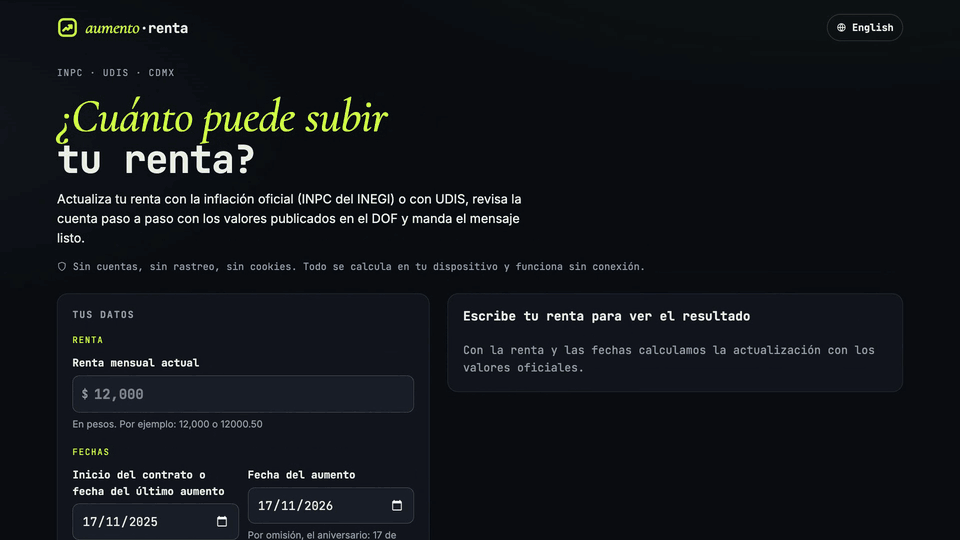
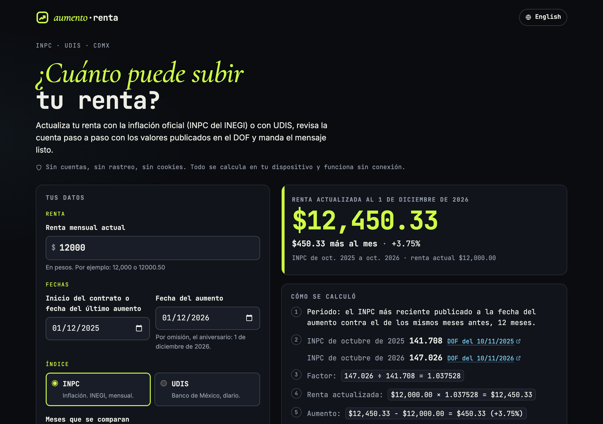
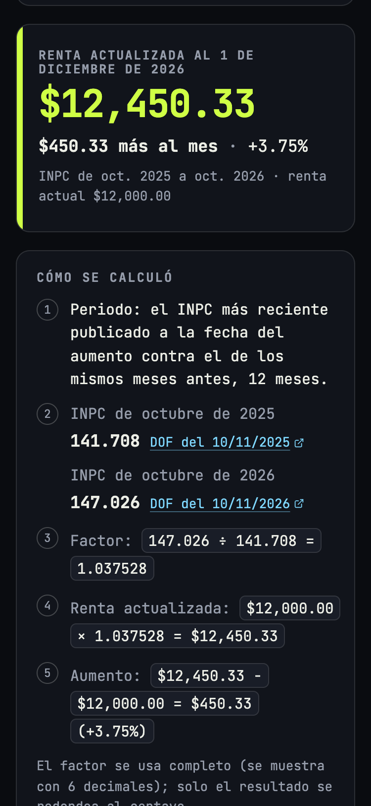
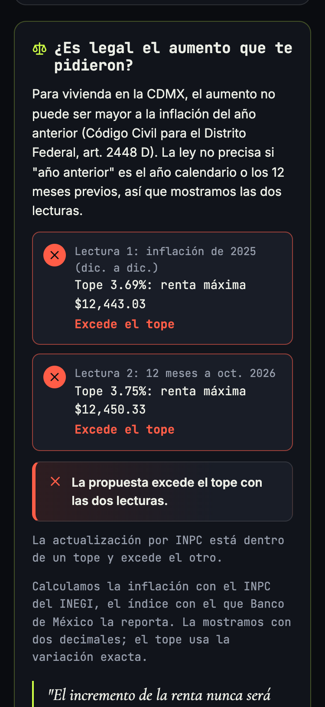
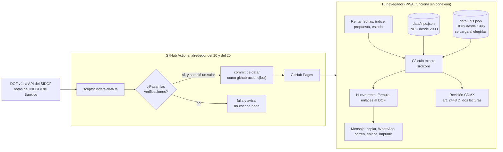

<p align="center">
  
</p>

<p align="center">
  <a href="https://github.com/BEG-lag/aumento-renta/actions/workflows/ci.yml"></a>
  <a href="https://github.com/BEG-lag/aumento-renta/actions/workflows/deploy.yml"></a>
  <a href="https://github.com/BEG-lag/aumento-renta/actions/workflows/update-data.yml"></a>
  <a href="LICENSE"></a>
  
</p>

<p align="center"><a href="README.md">English</a> · <b>Español</b></p>

<!-- demo:start -->
<p align="center">
  
</p>
<p align="center"><sub>Grabación real de <a href="https://beg-lag.github.io/aumento-renta/">la app en vivo</a>. <a href="assets/demo.mp4">Versión MP4</a>.</sub></p>
<!-- demo:end -->

# aumento·renta

**¿Cuánto puede subir tu renta?** Una pequeña app web instalable para México. Actualiza una renta (o cualquier cantidad) entre dos fechas con la inflación (el INPC que publica el INEGI) o con UDIS, muestra la cuenta paso a paso con los valores oficiales y el enlace a la nota del Diario Oficial de la Federación donde se publicó cada uno, revisa el tope legal de la Ciudad de México para vivienda y redacta un mensaje cordial y neutral para el arrendador o el inquilino.

**Úsala:** https://beg-lag.github.io/aumento-renta/ (en español, con opción en inglés).

> **Información, no asesoría.** No constituye opinión legal; valida con un abogado o la autoridad competente. Si una publicación oficial dice algo distinto, manda la publicación.

| Escritorio | Teléfono: el resultado | Teléfono: la revisión CDMX |
|---|---|---|
|  |  |  |

## Qué hace

- **Actualiza la renta** con el INPC (mensual, INEGI) o con UDIS (diario, Banco de México), entre el inicio del contrato o el último aumento y la fecha del aumento. Por omisión, la fecha del aumento es el aniversario.
- **Muestra la cuenta**: los dos valores del índice tal como se publicaron, cada uno con el enlace a su nota del DOF; el factor; la nueva renta; y la regla de redondeo. Nada es caja negra.
- **Te deja elegir qué meses se comparan**, porque la ley no lo dice y los contratos varían: los últimos publicados a la fecha del aumento (por omisión), el mes anterior a cada fecha (convención del art. 17-A del CFF), diciembre a diciembre, o dos meses cualesquiera.
- **Compara la propuesta del arrendador** (un porcentaje, una nueva renta o un aumento en pesos) con la actualización.
- **Revisión CDMX** para vivienda: "¿Es legal el aumento que te pidieron?" conforme al art. 2448 D del Código Civil, con las dos lecturas de "la inflación del año anterior". No revisa otros estados y lo dice, en vez de inventar.
- **Avisa si el resultado es provisional**, por ejemplo un aumento el mes próximo cuyo INPC aún no sale, y cuándo debe publicarse el índice que corresponde.
- **Mensaje listo**: cópialo, ábrelo en WhatsApp o en tu correo, copia un enlace para compartir, o imprime un resumen de una página con las fuentes ([vista de impresión](assets/screenshots/print.png)).
- **Privada y sin conexión**: sin cuentas, sin servidor, sin analítica, sin cookies, sin peticiones a terceros (las fuentes tipográficas van incluidas). El enlace para compartir solo lleva números y fechas, después del `#`, que el navegador nunca envía a un servidor. PWA instalable que funciona sin conexión después de la primera visita.
- **Accesible**: controles etiquetados, uso con teclado, foco visible, el color nunca es el único indicador (cada veredicto tiene icono y texto), sin desplazamiento horizontal a 375 px, respeta `prefers-reduced-motion`.

## Ejemplo resuelto

Lo genera [`scripts/readme-example.ts`](scripts/readme-example.ts) con el propio código; una prueba falla si este bloque se desfasa.

<!-- example:start (generated by scripts/readme-example.ts, do not edit) -->
Renta de $12,000.00, contrato desde el 1 de diciembre de 2025, aumento el 1 de diciembre de 2026, vivienda en la Ciudad de México, y el arrendador pide 8%. Periodo por omisión: el INPC más reciente publicado en el DOF a la fecha del aumento contra el de 12 meses antes.

| Paso | Valor | Fuente oficial |
|---|---|---|
| INPC de octubre de 2025 | 141.708 | [DOF 10/11/2025](https://dof.gob.mx/nota_detalle.php?codigo=5772420&fecha=10/11/2025) |
| INPC de octubre de 2026 (último publicado a la fecha del aumento) | 147.026 | [DOF 10/11/2026](https://dof.gob.mx/nota_detalle.php?codigo=5803352&fecha=10/11/2026) |
| Factor | `147.026 ÷ 141.708 = 1.037528` | |
| **Renta actualizada** | `$12,000.00 × 1.037528` = **$12,450.33** (+3.75%, $450.33) | |
| Tope CDMX, lectura 1: inflación de 2025 (dic. a dic.) | 3.69%, renta máxima $12,443.03 | [DOF 09/01/2026](https://dof.gob.mx/nota_detalle.php?codigo=5778071&fecha=09/01/2026) |
| Tope CDMX, lectura 2: 12 meses a oct. 2026 | 3.75%, renta máxima $12,450.33 | [DOF 10/11/2026](https://dof.gob.mx/nota_detalle.php?codigo=5803352&fecha=10/11/2026) |
| El arrendador pide | $12,960.00 (+8.00%): **excede el tope con las dos lecturas** | |

La misma renta y fechas con las otras convenciones:

| Convención | Meses que se comparan | Renta actualizada |
|---|---|---:|
| Mes anterior a cada fecha (art. 17-A CFF) | nov. 2025 → oct. 2026 | $12,368.55 |
| Año anterior, dic. a dic. | dic. 2024 → dic. 2025 | $12,443.03 |
| UDIS, día a día | 17 de noviembre de 2025 (8.592233) → 17 de noviembre de 2026 (8.913896) | $12,449.24 |

<details><summary>El mensaje que redacta (inquilino)</summary>

```text
Hola. Te escribo sobre la actualización de la renta que aplicaría a partir del 1 de diciembre de 2026.

Con el Índice Nacional de Precios al Consumidor (INPC) que publica el INEGI en el Diario Oficial de la Federación, de octubre de 2025 (141.708) a octubre de 2026 (147.026), la inflación del periodo fue de 3.75%. Aplicada a la renta actual de $12,000.00, la renta actualizada sería de $12,450.33, es decir, $450.33 más al mes.

La propuesta de $12,960.00 equivale a un aumento de 8.00% ($960.00 al mes).

Para vivienda en la Ciudad de México, el artículo 2448 D del Código Civil para el Distrito Federal dice que el incremento de la renta no será mayor a la inflación del año anterior (3.69% en 2025, de diciembre a diciembre; 3.75% en los 12 meses a octubre de 2026).

Te comparto el cálculo con los valores oficiales y sus fuentes: https://beg-lag.github.io/aumento-renta/#m=12000&i=inpc&a=2025-12-01&b=2026-12-01&p=published&e=cdmx&u=housing&pk=percent&pv=8

¿Lo platicamos? Gracias.
```

</details>
<!-- example:end -->

Las dos lecturas no coinciden a propósito: el art. 2448 D limita el aumento a "la inflación reportada por el Banco de México en el año anterior" sin decir si es el año calendario o los últimos 12 meses. La app muestra las dos y nunca elige por ti.

## Cómo funciona



Toda la aritmética es exacta: los índices se leen de su texto decimal publicado como fracciones ([`src/core/rational.ts`](src/core/rational.ts)), el factor nunca se redondea y el dinero se redondea una sola vez, al final, al centavo (mitad hacia arriba). El cálculo está en [`src/core/calculate.ts`](src/core/calculate.ts).

## Fuentes

Todas se consultaron el 17 de noviembre de 2026. Los detalles, citas, anomalías encontradas y lo que no se pudo verificar están en **[docs/fuentes.md](docs/fuentes.md)**.

| Qué | Fuente oficial | ¿Token? |
|---|---|---|
| INPC desde agosto de 2018 (base 2a. quincena de julio de 2018 = 100) | Publicación mensual del INEGI en el DOF, leída con la [API pública del SIDOF](https://sidof.segob.gob.mx/datos_abiertos) de la Secretaría de Gobernación. Ejemplo: [DOF 10/11/2026, nota 5803352](https://dof.gob.mx/nota_detalle.php?codigo=5803352&fecha=10/11/2026) | No |
| INPC de enero de 2003 a julio de 2018 | [Datos abiertos del INEGI](https://www.inegi.org.mx/programas/inpc/2018/#datos_abiertos) (`inpc_indicador_mensual_csv.zip`, serie reexpresada). Los 72 meses que comparte con el DOF coinciden exactamente | No |
| UDIS diarias desde el 4 de abril de 1995 | Indicador 159 del SIDOF, verificado contra cada nota del Banco de México en el DOF desde 2018. Ejemplo: [DOF 10/11/2026, nota 5803350](https://dof.gob.mx/nota_detalle.php?codigo=5803350&fecha=10/11/2026) | No |
| Plazo de publicación del INPC | Código Fiscal de la Federación, art. 20 ("dentro de los primeros diez días del mes siguiente") | |
| Convención "mes anterior a cada fecha" | Código Fiscal de la Federación, art. 17-A | |
| Tope en la CDMX | Código Civil para el Distrito Federal, art. 2448 D, segundo párrafo, reformado en la [Gaceta Oficial de la Ciudad de México núm. 1433, 28/08/2024](https://paot.org.mx/centro/codigos/df/pdf/2024/GOCDMX_28_08_2024_4.pdf), p. 4; vigente desde el 29/08/2024 | |

**No** se usan las API oficiales que piden token (la API del BIE del INEGI y la del SIE del Banco de México). Se encontraron y resolvieron dos problemas en los datos: el DOF publicó el INPC de agosto de 2018 como 100.942 y el INEGI lo corrigió al día siguiente a 100.492 (la app usa la corrección y la enlaza), y el SIDOF devuelve valores de UDI duplicados o faltantes en 8 días entre 2004 y 2012 (resueltos con las notas del DOF).

## Actualización de datos

[`update-data.yml`](.github/workflows/update-data.yml) corre los días 8 a 13 y 24 a 27 de cada mes y cada lunes. Lee las notas nuevas del INPC y de las UDIS en el DOF, las verifica (variación mensual impresa, mes anterior, cada UDI contra su tabla del DOF) y se detiene sin escribir nada ante cualquier inconsistencia. Solo si cambió algún valor corre las pruebas, hace commit de `data/` como `github-actions[bot]` y vuelve a publicar el sitio.

| Archivo | Tamaño | gzip | Se carga |
|---|---:|---:|---|
| `data/inpc.json` (286 meses) | 25 KB | 5 KB | con la app |
| `data/udis.json` (11,559 días) | 158 KB | 46 KB | solo al elegir UDIS |

## Desarrollo

Requiere Node 22.18 o posterior (TypeScript corre directo en los scripts).

```bash
npm ci
npm run dev           # http://localhost:5174/aumento-renta/
npm test              # Vitest
npm run typecheck && npm run lint && npm run check:dashes
npm run build         # sitio estático en dist/
npm run data:update   # trae del DOF los valores nuevos del INPC y de las UDIS
npm run data:backfill # reconstruye data/ desde cero (unas 1,000 solicitudes al SIDOF, con pausas y caché en .cache/)
npm run readme:sync   # regenera el ejemplo en los dos README
npm run screenshots   # capturas del README + pruebas en navegador (Google Chrome local; usa CHROME_PATH)
```

91 pruebas de Vitest, con cobertura de 100% en líneas. Incluyen ejemplos resueltos a mano con valores publicados, los lectores del DOF contra notas reales en [`test/fixtures`](test/fixtures) (incluida la corrección de 2018 y cinco formatos de tabla de UDIS), casos límite de fechas (29 de febrero, meses sin día 31, publicación el 8 o el 9), resultados provisionales, la regla de la CDMX, el mensaje y el enlace. Las pruebas en navegador cubren el ejemplo resuelto, el uso con teclado, las etiquetas, que no haya desplazamiento horizontal a 375 px, el inglés, la carga de UDIS, el portapapeles, la vista de impresión y el uso sin conexión.

```
src/core/        aritmética exacta, fechas, series, cálculo, mensaje, enlace
src/data/        lectores del DOF y tipos de datos
src/app/         interfaz (TypeScript sin framework), idiomas, estado
data/            inpc.json y udis.json con sus fuentes
scripts/         actualizador de datos, ejemplo del README, capturas, iconos, revisión de guiones largos
docs/fuentes.md  cada fuente, regla y verificación
```

## Limitaciones

- Solo se revisa la regla de la Ciudad de México. Los códigos civiles de otros estados pueden ser distintos, y los locales u oficinas se rigen por el contrato.
- La ley no dice si "el año anterior" es el año calendario o los últimos 12 meses, ni si se pueden acumular aumentos no aplicados. Se muestran las dos lecturas y el tope se compara para un solo año.
- El INPC anterior a agosto de 2018 viene de la serie reexpresada del INEGI; un contrato que cite los valores originales en base 2010 puede diferir en el último decimal.
- El archivo de datos abiertos del INEGI se quedó en julio de 2024, así que los meses recientes dependen solo del DOF (verificados con la variación impresa y el mes anterior).
- La actualización depende de la API del SIDOF, documentada por observación y no por una especificación oficial. Si cambia, la actualización falla y avisa, y la app conserva los últimos datos buenos.
- GitHub puede retrasar las tareas programadas y las desactiva tras 60 días sin actividad en el repositorio (los commits de datos cuentan como actividad).
- Quedan fuera los impuestos (ISR, IVA en rentas comerciales), las cuotas de mantenimiento y los depósitos.

## Aviso

Información, no asesoría. No constituye opinión legal; valida con un abogado o la autoridad competente. Este proyecto no tiene relación con el INEGI, el Banco de México, la Secretaría de Gobernación ni el Gobierno de la Ciudad de México. Las reglas pueden cambiar por publicación oficial.

## Autor

**Benjamín Esponda García**, abogado en la Ciudad de México que construye con IA.
[pivotek.mx](https://pivotek.mx) · [Portafolio de IA](https://github.com/BEG-lag/portafolio-ia) · [GitHub](https://github.com/BEG-lag)

Para abogados: [Con Criterio](https://concriterio.mx), kit de IA para la práctica legal en México (guía, plugins y skills de Claude Code, incluido arrendamiento).

## Licencia

[MIT](LICENSE). Tipografías: JetBrains Mono, Inter y Cormorant Garamond (SIL Open Font License), incluidas vía Fontsource. Los valores de los índices son información pública oficial del INEGI y del Banco de México, tal como se publican en el Diario Oficial de la Federación.
