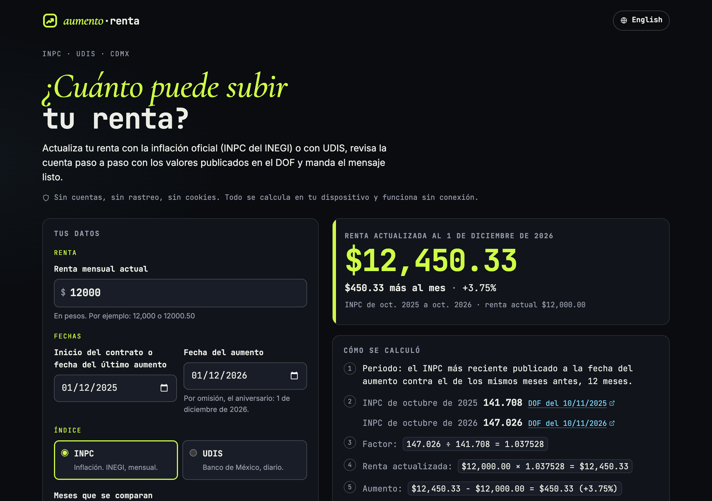
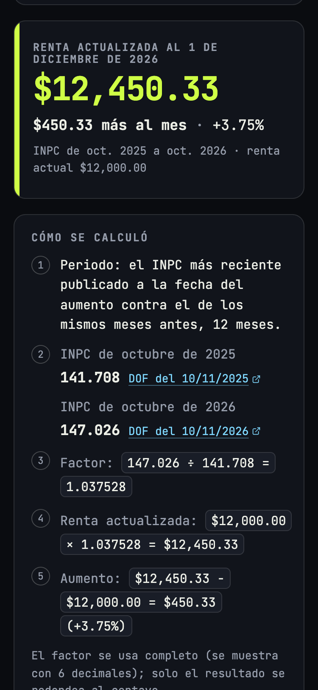
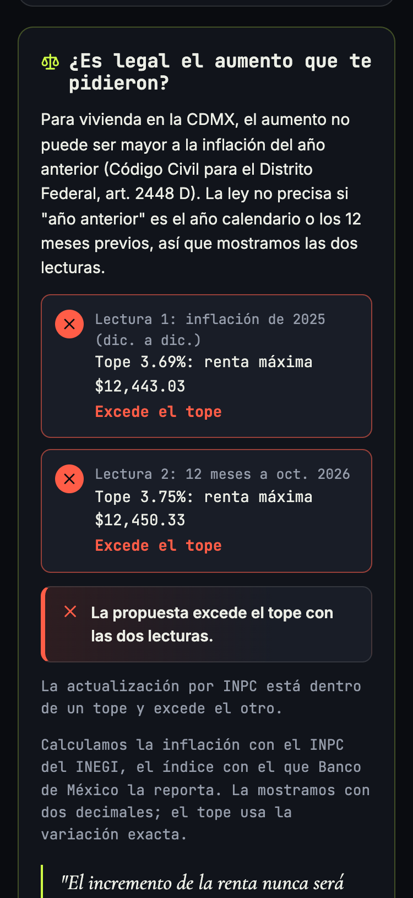
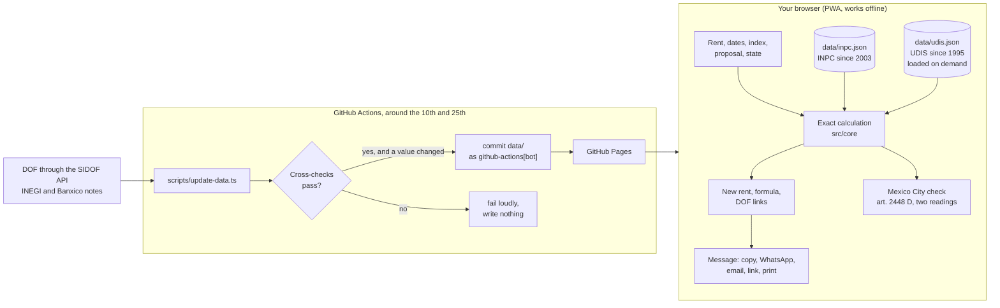

<p align="center">
  
</p>

<p align="center">
  <a href="https://github.com/BEG-lag/aumento-renta/actions/workflows/ci.yml"></a>
  <a href="https://github.com/BEG-lag/aumento-renta/actions/workflows/deploy.yml"></a>
  <a href="https://github.com/BEG-lag/aumento-renta/actions/workflows/update-data.yml"></a>
  <a href="LICENSE"></a>
  
</p>

<p align="center"><b>English</b> · <a href="README.es.md">Español</a></p>

# aumento·renta

**How much can your rent go up?** A small installable web app for people in Mexico. It updates a rent (or any amount) between two dates with inflation (the INPC that INEGI publishes) or with UDIS, shows the math step by step with the official index values and a link to the Diario Oficial de la Federación issue where each one was published, checks Mexico City's legal cap for homes, and writes a polite, neutral message for the landlord or the tenant.

**Use it:** https://beg-lag.github.io/aumento-renta/ (Spanish by default, English toggle).

> **Information, not legal advice.** This is not a legal opinion; check with a lawyer or the competent authority. When an official publication says something different, the publication wins.

| Desktop | Phone: the result | Phone: the Mexico City check |
|---|---|---|
|  |  |  |

## What it does

- **Updates the rent** with the INPC (monthly, INEGI) or with UDIS (daily, Banco de México), between the start of the lease or the last increase and the increase date. The increase date defaults to the anniversary.
- **Shows its work**: the two index values, exactly as published, each linked to its DOF note; the factor; the new rent; and the rounding rule. Nothing is a black box.
- **Lets you choose which months are compared**, because the law does not say and contracts differ: the latest published by the increase date (default), the month before each date (CFF art. 17-A convention), December to December, or any two months.
- **Checks the landlord's proposal** (a percentage, a new rent or an increase in pesos) against the update.
- **Mexico City check** for homes: "Is the increase you were asked for legal?" under Civil Code art. 2448 D, with both readings of "the previous year's inflation". Other states are not checked, and the app says so instead of guessing.
- **Says when a result is provisional**, for example an increase next month whose INPC is not out yet, and when the right index is due.
- **Ready-to-send message**: copy it, open it in WhatsApp or email, copy a share link, or print a one-page summary with the sources ([print view](assets/screenshots/print.png)).
- **Private and offline**: no accounts, no server, no analytics, no cookies, no third-party requests (fonts are self-hosted). The share link carries only numbers and dates, after the `#`, which browsers never send to a server. Installable PWA that works offline after the first visit.
- **Accessible**: labelled controls, keyboard friendly, visible focus, color never carries meaning alone (every verdict has an icon and text), no horizontal scroll at 375 px, respects `prefers-reduced-motion`.

## Worked example

Generated by [`scripts/readme-example.ts`](scripts/readme-example.ts) from the code itself; a test fails if this block drifts.

<!-- example:start (generated by scripts/readme-example.ts, do not edit) -->
Rent $12,000.00, lease from December 1, 2025, increase on December 1, 2026, a home in Mexico City, and the landlord asks for 8%. Default period: the latest INPC published in the DOF by the increase date against the one 12 months earlier.

| Step | Value | Official source |
|---|---|---|
| INPC October 2025 | 141.708 | [DOF 2025-11-10](https://dof.gob.mx/nota_detalle.php?codigo=5772420&fecha=10/11/2025) |
| INPC October 2026 (latest published by the increase date) | 147.026 | [DOF 2026-11-10](https://dof.gob.mx/nota_detalle.php?codigo=5803352&fecha=10/11/2026) |
| Factor | `147.026 ÷ 141.708 = 1.037528` | |
| **Updated rent** | `$12,000.00 × 1.037528` = **$12,450.33** (+3.75%, $450.33) | |
| Mexico City cap, reading 1: inflation in 2025 (Dec to Dec) | 3.69%, maximum rent $12,443.03 | [DOF 2026-01-09](https://dof.gob.mx/nota_detalle.php?codigo=5778071&fecha=09/01/2026) |
| Mexico City cap, reading 2: 12 months to Oct 2026 | 3.75%, maximum rent $12,450.33 | [DOF 2026-11-10](https://dof.gob.mx/nota_detalle.php?codigo=5803352&fecha=10/11/2026) |
| Landlord asks for | $12,960.00 (+8.00%): **above the cap under both readings** | |

Same rent and dates with the other conventions:

| Convention | Months compared | Updated rent |
|---|---|---:|
| Month before each date (CFF art. 17-A) | Nov 2025 → Oct 2026 | $12,368.55 |
| Previous year, Dec to Dec | Dec 2024 → Dec 2025 | $12,443.03 |
| UDIS, day to day | November 17, 2025 (8.592233) → November 17, 2026 (8.913896) | $12,449.24 |

<details><summary>The message it writes (tenant)</summary>

```text
Hi. I am writing about the rent update that would apply from December 1, 2026.

Using the National Consumer Price Index (INPC) published by INEGI in the Diario Oficial de la Federación, from October 2025 (141.708) to October 2026 (147.026), inflation for the period was 3.75%. Applied to the current rent of $12,000.00, the updated rent would be $12,450.33, that is, $450.33 more per month.

The proposed rent of $12,960.00 is an increase of 8.00% ($960.00 per month).

For homes in Mexico City, article 2448 D of the Civil Code for the Federal District says the rent increase may not exceed the previous year's inflation (3.69% in 2025, December to December; 3.75% in the 12 months to October 2026).

Here is the calculation with the official values and their sources: https://beg-lag.github.io/aumento-renta/#m=12000&i=inpc&a=2025-12-01&b=2026-12-01&p=published&e=cdmx&u=housing&pk=percent&pv=8

Can we talk it over? Thank you.
```

</details>
<!-- example:end -->

The two readings disagree on purpose: art. 2448 D caps the increase at "the inflation reported by Banco de México for the previous year" without saying whether that is the calendar year or the last 12 months. The app shows both and never picks one for you.

## How it works



All arithmetic is exact: index values are parsed from their published decimal strings into fractions ([`src/core/rational.ts`](src/core/rational.ts)), the factor is never rounded, and money is rounded once, at the end, to the centavo (half away from zero). The calculation is in [`src/core/calculate.ts`](src/core/calculate.ts).

## Sources

Every source was read on 17 Nov 2026. Details, quotes, anomalies found and what could not be verified are in **[docs/fuentes.md](docs/fuentes.md)** (Spanish).

| What | Official source | Token? |
|---|---|---|
| INPC, Aug 2018 onward (base 2nd half of July 2018 = 100) | INEGI's monthly publication in the DOF, read through the public [SIDOF API](https://sidof.segob.gob.mx/datos_abiertos) of the Secretaría de Gobernación. Example: [DOF 2026-11-10, note 5803352](https://dof.gob.mx/nota_detalle.php?codigo=5803352&fecha=10/11/2026) | No |
| INPC, Jan 2003 to Jul 2018 | [INEGI open data](https://www.inegi.org.mx/programas/inpc/2018/#datos_abiertos) (`inpc_indicador_mensual_csv.zip`, re-based series). The 72 months it shares with the DOF match exactly | No |
| UDIS, daily since 1995-04-04 | SIDOF indicator 159, checked against every Banco de México DOF note since 2018. Example: [DOF 2026-11-10, note 5803350](https://dof.gob.mx/nota_detalle.php?codigo=5803350&fecha=10/11/2026) | No |
| Publication deadline of the INPC | Código Fiscal de la Federación, art. 20 ("dentro de los primeros diez días del mes siguiente") | |
| "Month before each date" convention | Código Fiscal de la Federación, art. 17-A | |
| Mexico City cap | Código Civil para el Distrito Federal, art. 2448 D, 2nd paragraph, amended in the [Gaceta Oficial de la Ciudad de México no. 1433, 28 Aug 2024](https://paot.org.mx/centro/codigos/df/pdf/2024/GOCDMX_28_08_2024_4.pdf), p. 4; in force since 29 Aug 2024 | |

The token-based official APIs (INEGI's BIE API and Banco de México's SIE API) are **not** used. Two data problems were found and handled: the DOF printed the August 2018 INPC as 100.942 and INEGI corrected it to 100.492 the next day (the app uses the correction and links it), and SIDOF returns duplicate or missing UDI values on 8 days between 2004 and 2012 (settled with the DOF notes).

## Data refresh

[`update-data.yml`](.github/workflows/update-data.yml) runs on days 8 to 13 and 24 to 27 of each month and every Monday. It reads the new INPC and UDI notes from the DOF, cross-checks them (printed monthly variation, previous month, each UDI against its DOF table), and stops without writing anything on any inconsistency. Only when a value changed does it run the tests, commit `data/` as `github-actions[bot]` and redeploy Pages.

| File | Size | gzip | Loaded |
|---|---:|---:|---|
| `data/inpc.json` (286 months) | 25 KB | 5 KB | with the app |
| `data/udis.json` (11,559 days) | 158 KB | 46 KB | only when you pick UDIS |

## Development

Requires Node 22.18 or later (TypeScript runs natively in the scripts).

```bash
npm ci
npm run dev           # http://localhost:5174/aumento-renta/
npm test              # Vitest
npm run typecheck && npm run lint && npm run check:dashes
npm run build         # static site in dist/
npm run data:update   # fetch new INPC and UDIS values from the DOF
npm run data:backfill # rebuild data/ from scratch (about 1,000 polite SIDOF requests, cached in .cache/)
npm run readme:sync   # regenerate the worked example in both READMEs
npm run screenshots   # README screenshots + browser smoke checks (local Google Chrome; set CHROME_PATH)
```

The tests include worked examples with real published values computed by hand, the DOF parsers against real notes in [`test/fixtures`](test/fixtures) (including the 2018 correction and five UDI table formats), date edge cases (February 29, months without the 31st, publication on the 8th or 9th), provisional results, the Mexico City rule, the message and the share link. The browser checks cover the worked example, keyboard use, labels, no horizontal scroll at 375 px, English, UDIS loading, the clipboard, the print view and offline use.

```
src/core/        exact arithmetic, dates, series, calculation, message, share link
src/data/        DOF parsers and data types
src/app/         UI (vanilla TypeScript), i18n, state
data/            inpc.json and udis.json with their sources
scripts/         data updater, README example, screenshots, icons, em dash check
docs/fuentes.md  every source, rule and check (Spanish)
```

## Limitations

- Only Mexico City's rule is checked. Other states' civil codes may differ, and leases of shops or offices follow the contract.
- The law does not say whether "the previous year" is the calendar year or the last 12 months, nor whether skipped increases can be added up. Both readings are shown; the cap is compared for a single year.
- INPC values before August 2018 come from INEGI's re-based series; a contract that quotes the original base-2010 values may differ in the last decimal.
- INEGI's open-data file stopped in July 2024, so recent months rely on the DOF alone (cross-checked by the printed variation and previous month).
- The refresh depends on the SIDOF API, whose behavior is documented by observation, not by an official spec. If it changes, the refresh fails loudly and the app keeps the last good data.
- GitHub may delay scheduled runs, and disables them after 60 days without repository activity (data commits count as activity).
- Taxes (ISR, IVA on commercial rents), maintenance fees and deposits are out of scope.

## Disclaimer

Information, not legal advice. This is not a legal opinion; check with a lawyer or the competent authority. This project is not affiliated with INEGI, Banco de México, the Secretaría de Gobernación or the Government of Mexico City. Rules can change by official publication.

## Author

**Benjamín Esponda García**, a lawyer in Mexico City who builds with AI.
[pivotek.mx](https://pivotek.mx) · [AI portfolio](https://github.com/BEG-lag/portafolio-ia) · [GitHub](https://github.com/BEG-lag)

For lawyers: [Con Criterio](https://concriterio.mx), an AI toolkit for legal practice in Mexico (guide, Claude Code plugins and skills, leases included).

## License

[MIT](LICENSE). Fonts: JetBrains Mono, Inter and Cormorant Garamond (SIL Open Font License), self-hosted via Fontsource. Index values are public official information from INEGI and Banco de México as published in the Diario Oficial de la Federación.
